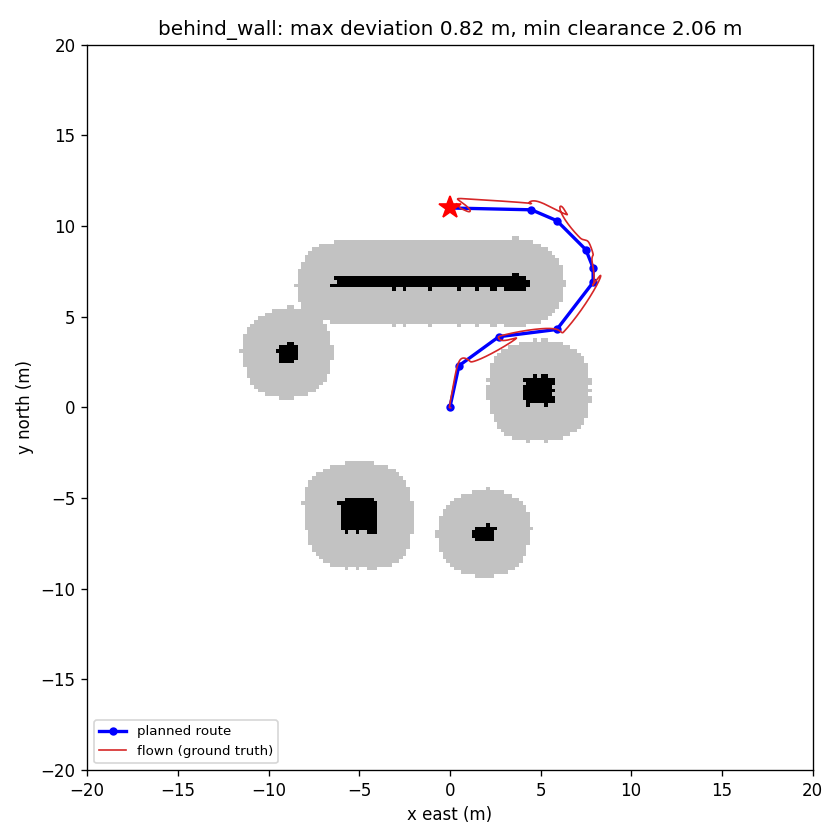
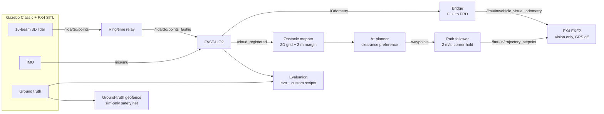

# GPS-Denied Drone Navigation with Lidar-Inertial SLAM

**Shubham Worlikar** · [LinkedIn](https://www.linkedin.com/in/shubham-worlikar-7a5b33279) · [GitHub](https://github.com/worshub05)

Autonomous quadrotor navigation without GPS, in simulation. A PX4 drone localises itself with
FAST-LIO2 (3D lidar + IMU), builds an obstacle map, plans a safe route with A*, and flies around
obstacles to a goal it cannot see from takeoff, with GPS and magnetometer disabled.



*Planned route (blue) and the drone's true flown path (red) around a wall, GPS off.
Black: mapped obstacles. Grey: 2 m safety margin.*

## Highlights

- **GPS-denied flight:** PX4's estimator (EKF2) fuses only the FAST-LIO2 pose for position,
  height and heading. GPS and magnetometer are switched off.
- **End-to-end navigation:** map, plan and fly to a goal behind a wall. The drone stayed within
  0.82 m of the planned route, never came closer than 2.06 m to an obstacle, and landed 0.49 m
  from the goal (single run).
- **Long flight on SLAM alone:** 0.32 m RMSE over about 155 m at 2 m/s, matching the same
  survey flown with GPS (0.31 m).
- **Measured, not eyeballed:** every result is scored against simulator ground truth with
  [evo](https://github.com/MichaelGrupp/evo), using airborne-only metrics.

**Stack:** ROS 2 Humble, PX4 v1.14.3 (SITL), Gazebo Classic 11, FAST-LIO2 (ROS 2 port),
Micro XRCE-DDS, Python (rclpy, NumPy, SciPy, Matplotlib), evo, Ubuntu 22.04 on WSL2.

## Architecture



## Results

### Localization accuracy (airborne only, vs ground truth)

| Run | Airborne path | RMSE | Max |
|-----|---------------|------|-----|
| PX4 estimator with GPS, square | 48 m | 0.104 m | 0.175 m |
| FAST-LIO2, bag replay, square | 28 m | 0.178 m | 0.414 m |
| FAST-LIO2 live, square, GPS flying the drone | 28 m | 0.170 m | 0.388 m |
| FAST-LIO2 live, survey pattern, GPS flying the drone | 155 m | 0.309 m | 0.700 m |
| **SLAM only (GPS off), square** | 28 m | **0.138 m** | 0.388 m |
| SLAM only, survey pattern, default speed | 175 m | 0.646 m | 1.333 m |
| **SLAM only, survey pattern, 2 m/s** | 155 m | **0.320 m** | 0.945 m |

Full method and per-run details: [results/week2_summary.md](results/week2_summary.md).

### Mapping and navigation

| Stage | Result |
|-------|--------|
| Obstacle map (from FAST-LIO2 point cloud) | all 6 objects found within ~0.2 m, no false obstacles |
| Planner, open route (`past_rock`) | 9.6 m, minimum planned clearance 3.42 m |
| Planner, around the wall (`behind_wall`) | 21.7 m, minimum planned clearance 2.40 m |
| Flight, `past_rock` (GPS off) | max 0.97 m from route, min real clearance 2.86 m, landed 1.13 m from goal |
| Flight, `behind_wall` (GPS off) | max 0.82 m from route, min real clearance 2.06 m, landed 0.49 m from goal, 44 s |

Details: [Day 15](results/day15_mapping.md), [Day 16](results/day16_planner.md),
[Day 17](results/day17_path_following.md), [Day 18](results/day18_demo.md).

## Key findings

1. **Per-point lidar timing matters.** Gazebo's lidar gives no per-point timestamps. Deriving
   each point's time from its azimuth in the sweep cut FAST-LIO2's error from 0.349 m to
   0.124 m in bag replay (ground time included).
2. **Visualisation can break real-time SLAM.** RViz used about 119% CPU during live runs.
   Turning it off brought live error from 0.18-0.19 m back to 0.12 m (ground time included).
3. **Speed matters once SLAM is in the control loop.** At PX4's default speed, SLAM-only error
   doubled (0.646 m) and the drone strayed to within 0.15 m of where a wall had been planned.
   Limiting speed to 2 m/s gave 0.320 m with no drift growth over time.
4. **The lidar sees the drone's own rotors.** Returns just beyond FAST-LIO2's 0.3 m cutoff
   created a false obstacle over the whole flight area. A 1 m self-filter in the mapper fixed it.
5. **A hover drift is not fully explained.** The first SLAM-only hover drifted 1.75 m east-west
   while the estimate stayed near zero. A later hover in the same world was stable. Geometric
   degeneracy (few surfaces constraining east-west motion) is the suspected cause; it has not
   been confirmed experimentally.
6. **Evaluation pitfalls, caught and corrected:** time spent on the ground inflated accuracy
   (all headline figures are now airborne-only); FAST-LIO2 (x forward, y left, z up) and PX4
   (x forward, y right, z down) frames differ, with a 90-degree heading offset to north; and a
   launch file edited in `src/` but not rebuilt meant a modified world was never loaded. The
   correction is recorded in the results files.

## Limitations

- Simulation only, in a small world with six objects.
- Most results come from single runs, so they are indicative rather than averages.
- The map treats unseen space as free, and it is built from a prior survey flight.
- The drone deviates up to about 1 m from its planned route, so planning relies on a 2 m margin.
- Planning is 2D, at a fixed flight height.
- The map frame assumes takeoff from the same spawn pose as the survey (about 0.2 m agreement).

## Repository layout

| Path | Contents |
|------|----------|
| `src/drone_control/` | ROS 2 package: drone model (3D lidar, IMU, ground truth), worlds, launch file, square and hover flight nodes, FAST-LIO2 config (`config/gps_denied_3d.yaml`) |
| `tools/` | relay, PX4 bridge, mapper, A* planner, path follower, flight scripts, geofence, evaluation and plotting scripts, `stop_all.sh` |
| `results/` | per-day result notes, summary tables and plots |
| `maps/` | saved obstacle map and planned routes |
| `docs/` | RViz layout for replaying flights (`demo.rviz`) |

## Setup

Tested on Ubuntu 22.04 (WSL2) with ROS 2 Humble, PX4-Autopilot v1.14.3 (Gazebo Classic SITL)
and the Micro XRCE-DDS Agent. `px4_msgs` matching PX4 v1.14 must be built in the workspace.

```bash
# workspace
git clone git@github.com:worshub05/gps-denied-drone-slam.git ~/gpsdenied_ws
cd ~/gpsdenied_ws/src

# FAST-LIO2 (ROS 2 port) and its Livox dependency
sudo apt install -y ros-humble-pcl-ros libpcl-dev libeigen3-dev
git clone https://github.com/Livox-SDK/Livox-SDK2.git
(cd Livox-SDK2 && mkdir -p build && cd build && cmake .. && make -j4 && sudo make install)
git clone https://github.com/Livox-SDK/livox_ros_driver2.git
(cd livox_ros_driver2 && ./build.sh humble)
git clone -b ros2 --recursive https://github.com/Ericsii/FAST_LIO.git
cp drone_control/config/gps_denied_3d.yaml FAST_LIO/config/

# build
cd ~/gpsdenied_ws && source /opt/ros/humble/setup.bash
colcon build --symlink-install && source install/setup.bash

# custom drone model takes priority over PX4's stock model
echo 'export GAZEBO_MODEL_PATH=$HOME/gpsdenied_ws/src/drone_control/models:$GAZEBO_MODEL_PATH' >> ~/.bashrc

# evaluation
python3 -m pip install --user evo
```

### PX4 settings for GPS-denied flight

With the simulator running:

```bash
cd ~/PX4-Autopilot/build/px4_sitl_default/bin
./px4-param set EKF2_EV_CTRL 11      # vision: horizontal + vertical position + heading
./px4-param set EKF2_GPS_CTRL 0      # GPS off
./px4-param set EKF2_HGT_REF 3       # height from vision
./px4-param set EKF2_EV_DELAY 50     # FAST-LIO2 latency (ms)
./px4-param set EKF2_MAG_TYPE 5      # magnetometer off (vision provides heading)
./px4-param set MPC_XY_VEL_MAX 2.0   # 2 m/s horizontal speed limit
./px4-param save
```

To fly with GPS again: `EKF2_EV_CTRL 0`, `EKF2_GPS_CTRL 7`, `EKF2_HGT_REF 1`, `EKF2_MAG_TYPE 0`.

Or use the helper: `tools/px4_params.sh slam` / `tools/px4_params.sh gps`.

## Running a GPS-denied flight

Start each in its own terminal (after `source ~/gpsdenied_ws/install/setup.bash`):

```bash
HEADLESS=1 ros2 launch drone_control outdoor_sim.launch.py            # simulator
python3 ~/gpsdenied_ws/tools/lidar_ring_time_relay.py                 # lidar timing relay
ros2 launch fast_lio mapping.launch.py config_file:=gps_denied_3d.yaml rviz:=false
python3 ~/gpsdenied_ws/tools/fastlio_to_px4.py                        # FAST-LIO2 -> PX4
python3 ~/gpsdenied_ws/tools/gt_geofence.py                           # sim-only safety net
python3 ~/gpsdenied_ws/tools/follow_path.py ~/gpsdenied_ws/maps/path_behind_wall.json
```

Plan a new route on the saved map, then evaluate a recorded flight:

```bash
python3 tools/astar_planner.py --goal 0 11 --name behind_wall
python3 tools/eval_path_follow.py <bag> maps/path_behind_wall.json
```

Stop everything with `tools/stop_all.sh`.

## Author

**Shubham Worlikar**: [LinkedIn](https://www.linkedin.com/in/shubham-worlikar-7a5b33279), [GitHub](https://github.com/worshub05)
